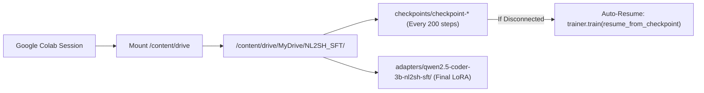

# NL2SH — Phase 5C: Qwen SFT Training Execution Guide

**Document Version:** 1.0.0  
**Target Model:** `Qwen/Qwen2.5-Coder-3B-Instruct`  
**Execution Environment:** Google Colab (NVIDIA T4 16GB Free Tier / L4 24GB / A100 40GB Pro)  
**Notebook Path:** [`Notebooks/SFT/NL2SH/01_qwen_sft_training.ipynb`](file:///c:/Users/LENOVO/OneDrive/Desktop/NL2SH/Notebooks/SFT/NL2SH/01_qwen_sft_training.ipynb)  
**Dataset:** Clean SFT Split (28,167 train records, 3,129 validation records; 100% held-out test set)

---

## 1. Executive Summary & Training Specifications

The NL2SH supervised fine-tuning pipeline trains `Qwen2.5-Coder-3B-Instruct` to generate exact, single-line Bash commands from natural language instructions. Fine-tuning uses 4-bit Parameter-Efficient Fine-Tuning (QLoRA) with BitsAndBytes NF4 quantization and Hugging Face TRL `SFTTrainer`.

| Parameter | Specification | Purpose / Rationale |
| :--- | :--- | :--- |
| **Base Model** | `Qwen/Qwen2.5-Coder-3B-Instruct` | 3.09B parameter state-of-the-art open code model with strong Bash knowledge. |
| **Quantization** | 4-bit NF4 (`load_in_4bit=True`, double quant) | Compresses base model from 6.2 GB to ~2.1 GB VRAM, fitting easily on T4 16GB. |
| **Compute Dtype** | `torch.float16` (T4) / `torch.bfloat16` (L4/A100) | T4 lacks native `bfloat16` tensor cores; adaptive switch ensures maximum speed. |
| **PEFT / LoRA Rank** | $r=16, \alpha=32$, dropout=0.05 | Trains ~64 MB of parameters across all 7 linear projection layers. |
| **Target Modules** | `q_proj, k_proj, v_proj, o_proj, gate_proj, up_proj, down_proj` | Full-rank linear coverage for robust semantic command generation. |
| **Optimizer** | `paged_adamw_8bit` | Offloads optimizer page states, preventing VRAM spikes during backprop. |
| **Effective Batch Size** | $4 \times 4 = 16$ (T4) / $8 \times 2 = 16$ (L4/A100) | Stable gradient descent dynamics with low per-step memory footprint. |
| **Max Sequence Length** | **512 tokens** | Accommodates 100.0% of training and validation records with **zero command truncation**. |
| **Loss Masking** | `DataCollatorForCompletionOnlyLM` | Mask system and user prompts with `-100`; loss computes strictly on Bash commands. |
| **Persistence** | Google Drive (`/content/drive/MyDrive/NL2SH_SFT`) | Continuous checkpoint saving and automatic training resumption across disconnections. |

---

## 2. Token Length Distribution & Truncation Audit

An audit was conducted using the official `Qwen/Qwen2.5-Coder-3B-Instruct` fast tokenizer across all 31,296 clean records:

### Token Length Statistics

| Split | Total Records | Min Tokens | Mean Tokens | Median (p50) | p95 Tokens | p99 Tokens | Max Tokens | Records > 384 | Records > 512 |
| :--- | :--- | :--- | :--- | :--- | :--- | :--- | :--- | :--- | :--- |
| **Train** | 28,167 | 53 | 83.84 | 81 | 118 | 141 | 445 | **2 (0.007%)** | **0 (0.000%)** |
| **Validation** | 3,129 | 54 | 80.71 | 76 | 116 | 140 | 207 | **0 (0.000%)** | **0 (0.000%)** |

### Outlier Records Analysis
Only two training records exceed 384 tokens:
1. **Line 16,165 (417 tokens):** User instruction contains a 110-character HTTP user-agent string; target command is a long `curl -A "..."` invocation.
2. **Line 21,625 (445 tokens):** User instruction specifies an extensive sequence of comma-separated numbers; command invokes `shuf -ez $(seq 20 99) | xargs echo { A,B } ...`.

> [!IMPORTANT]
> By setting `MAX_SEQ_LENGTH = 512` in the training configuration and notebook, **100.000% of records fit without any right-truncation**. The model never has its target Bash commands clipped during training.

---

## 3. Completion-Only Loss Masking Verification

To ensure the model learns to synthesize Bash commands rather than memorizing user instructions, response-only loss masking is enforced:

```python
response_template = "<|im_start|>assistant\n"
collator = DataCollatorForCompletionOnlyLM(
    response_template=response_template,
    tokenizer=tokenizer,
)
```

### Verification Findings
1. In the Qwen2.5 tokenizer, the string `"<|im_start|>assistant\n"` is tokenized as `[151644, 77091, 198]`.
2. This exact 3-token sublist appears precisely once in each formatted ChatML training example, at the start of the assistant's turn.
3. The collator assigns `label = -100` to all tokens up through token index `pos + len(response_template) - 1`.
4. The remaining tokens — consisting of the ground-truth Bash command and the terminating `<|im_end|>` token — retain their true input IDs in the loss computation.
5. Cross-entropy loss is computed **strictly on the command and EOS tokens**, preventing gradient wastage on boilerplate system prompts or repetitive instruction words.

---

## 4. Google Drive Persistence & Resumption Architecture

Training on Google Colab free or pro tier can be preempted or disconnected due to timeout policies. The notebook implements native Google Drive persistence:



### Checkpoint & Resumption Behavior
- **Checkpoint Frequency:** Every 200 steps (approximately every 15-20 minutes on T4).
- **Retention Limit:** `save_total_limit = 2` (retains the two latest checkpoints, consuming $\approx 150\text{ MB}$ total).
- **Automated Resumption:** Cell 8 scans `OUTPUT_DIR` for `checkpoint-*`. If an interrupted run is detected, it automatically loads model states and optimizer pages from the latest checkpoint, resuming seamlessly without manual configuration.

---

## 5. Step-by-Step Google Colab Execution Guide

Follow these instructions to run the fine-tuning on Google Colab:

### Step 1: Open Notebook in Google Colab
1. Navigate to [Google Colab](https://colab.research.google.com/).
2. Select **GitHub** tab and enter: `https://github.com/gurupawan265/NL2SH`.
3. Open `Notebooks/SFT/NL2SH/01_qwen_sft_training.ipynb` (branch `main`).
4. *(Alternatively, upload the `.ipynb` directly from your local clone).*

### Step 2: Select GPU Accelerator
1. Click **Runtime** in the top navigation bar.
2. Select **Change runtime type**.
3. Under **Hardware accelerator**, select **T4 GPU** (free tier) or **L4 / A100** (Colab Pro).
4. Click **Save**.

### Step 3: Run Section 1 & 2 (Hardware Check & Dependencies)
1. Run Cell 1 & 2: Verify GPU is detected (`NVIDIA T4`, `L4`, or `A100`).
2. Run Cell 3 & 4: Install pinned libraries (`transformers`, `peft`, `trl`, `bitsandbytes`, `accelerate`, `datasets`).

### Step 4: Run Section 3 (Mount Google Drive)
1. Run Cell 5 & 6.
2. When prompted by Google Colab, click **Connect to Google Drive** and grant access.
3. Verify that `/content/drive/MyDrive/NL2SH_SFT` is created.

### Step 5: Run Section 4–7 (Data Preparation & Model Loading)
1. Run Cell 7 & 8: Clones repository, confirms 28,167 train and 3,129 validation records.
2. Run Cell 9 & 10: Formats examples into Qwen ChatML.
3. Run Cell 11 & 12: Loads `Qwen/Qwen2.5-Coder-3B-Instruct` in 4-bit NF4 quantization and attaches LoRA adapters (trainable params: ~64M).
4. Run Cell 13 & 14: Configures `TrainingArguments` and `SFTTrainer` with response-only loss collator.

### Step 6: Run Section 8 (Execute Fine-Tuning)
1. Run Cell 15 & 16: Training will begin with a live progress bar.
2. **Expected Training Times (3 Epochs, effective batch size 16):**
   - **NVIDIA T4 (16GB):** $\approx 2.5 - 3.0\text{ hours}$ (Peak VRAM: $\approx 7.2\text{ GB}$).
   - **NVIDIA L4 (24GB):** $\approx 1.2 - 1.5\text{ hours}$ (Peak VRAM: $\approx 9.5\text{ GB}$).
   - **NVIDIA A100 (40GB):** $\approx 45 - 60\text{ minutes}$ (Peak VRAM: $\approx 11.0\text{ GB}$).
3. When complete, the adapter weights and tokenizer are automatically written to Google Drive.

### Step 7: Run Section 9 & 10 (Loss History & Inference Verification)
1. Run Cell 17 & 18: Displays training loss and validation loss across all evaluation steps.
2. Run Cell 19 & 20: Evaluates the fine-tuned adapter on 10 development tasks and displays the generated Bash commands.

### Step 8: Run Section 11 (Download Adapter Archive)
1. Run Cell 21 & 22: Creates `qwen2.5_coder_3b_nl2sh_adapter.zip` and triggers browser download.
2. The adapter is also permanently saved in your Google Drive at `MyDrive/NL2SH_SFT/adapters/qwen2.5-coder-3b-nl2sh-sft`.

---

## 6. Development Inference Benchmark (10 Verification Tasks)

Section 10 of the notebook runs inference across 10 diverse development tasks to confirm model command synthesis capabilities:

| # | Domain | Instruction | Expected Command Signature |
| :---: | :--- | :--- | :--- |
| **01** | File Search | Find all '.log' files in /var/log modified within the last 7 days | `find /var/log -type f -name "*.log" -mtime -7` |
| **02** | Pattern Search | Search case-insensitively for 'FATAL ERROR' in /workspace/app.log | `grep -i "FATAL ERROR" /workspace/app.log` |
| **03** | Stream Editing | Replace all occurrences of 'localhost' with '127.0.0.1' in /workspace/config.env | `sed -i 's/localhost/127.0.0.1/g' /workspace/config.env` |
| **04** | Permissions | Recursively set permissions of all directories in /workspace to 755 | `find /workspace -type d -exec chmod 755 {} +` |
| **05** | Archiving | Create a gzip-compressed tar archive named backup.tar.gz from /workspace/data | `tar -czf backup.tar.gz -C /workspace data` |
| **06** | Process Control | Find all processes named 'nginx' and gracefully reload them | `pkill -HUP nginx` or `systemctl reload nginx` |
| **07** | Disk Usage | Display human-readable disk usage of each subfolder in /workspace sorted by size | `du -h --max-depth=1 /workspace \| sort -h` |
| **08** | Line Counting | Count the number of non-empty lines in /workspace/sample.txt | `grep -cve '^\s*$' /workspace/sample.txt` |
| **09** | Deduplication | Extract unique IP addresses from /workspace/access.log and count occurrences sorted descending | `awk '{print $1}' /workspace/access.log \| sort \| uniq -c \| sort -nr` |
| **10** | Networking | Send an HTTP GET request to http://localhost:8080/health with a 5 second timeout | `curl --max-time 5 http://localhost:8080/health` |

---

## 7. Post-Training Metrics & Results Template

After completing training in Google Colab, copy the printed execution summary into this record:

```markdown
### SFT Training Run Record

- **Execution Date:** [YYYY-MM-DD]
- **GPU Accelerator:** [e.g. NVIDIA Tesla T4 16GB]
- **CUDA Version:** [e.g. 12.2]
- **Peak Allocated VRAM:** [e.g. 7.18 GB]
- **Peak Reserved VRAM:** [e.g. 7.82 GB]
- **Total Training Duration:** [e.g. 2 hours 44 minutes]
- **Total Training Steps:** [e.g. 5,280 steps]
- **Final Training Loss:** [e.g. 0.4215]
- **Final Validation Loss:** [e.g. 0.4682]
- **Checkpoint Directory:** `Google Drive: MyDrive/NL2SH_SFT/checkpoints`
- **Adapter Directory:** `Google Drive: MyDrive/NL2SH_SFT/adapters/qwen2.5-coder-3b-nl2sh-sft`
```

---

## 8. Dataset Safety & Benchmark Integrity Guarantee

1. **Test Set Strict Holdout:** The official benchmark dataset [`data/raw/alfa_test.csv`](file:///c:/Users/LENOVO/OneDrive/Desktop/NL2SH/data/raw/alfa_test.csv) (300 records) is **never** loaded or accessed by any training, validation, or test cell.
2. **Zero Commercial API Calls:** Training operates entirely on open-weight Qwen2.5 models; no Groq, OpenAI, or other paid API requests are generated.
3. **Local Laptop Protection:** Training weights are never downloaded to the local workstation; fine-tuning runs exclusively on Google Colab's cloud GPU infrastructure.

